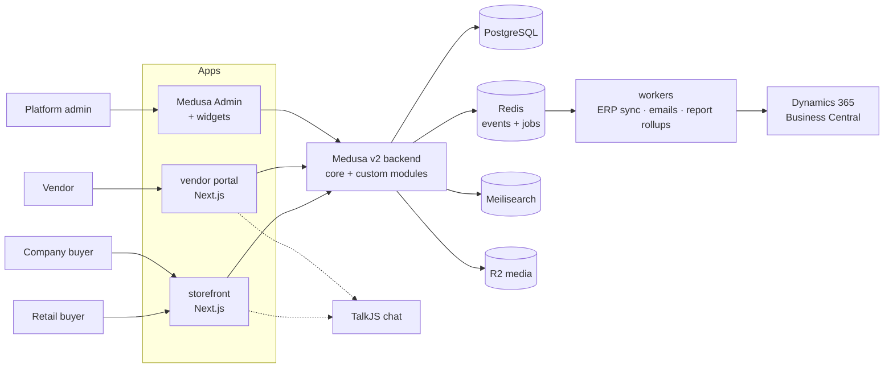
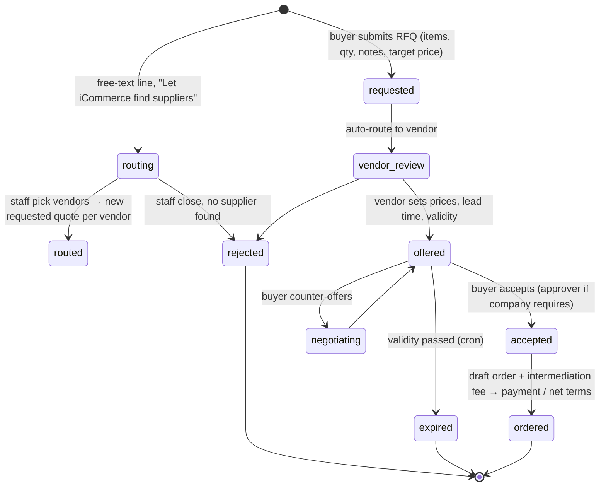

# 02 — Architecture

Status: draft v1 · Based on [01-wp-audit.md](01-wp-audit.md) · Payment gateway: **parked**

## Brand
**iCommerce** (rebrand of Gosoor), same palette: primary blue `#2a74ba`, navy `#1c1952`, white, accent red `#dd3333` (sale/new). Design via Claude Design → see design system artifact.

## Scope v1
- **B2C**: retail storefront, multi-vendor cart, checkout, reviews, wishlist.
- **B2B**: company accounts, KYC, RFQ/quotes, MOQ, unit of measure, tiered/contract prices, intermediation fee.
- **Vendor portal**: products, orders, quotes, chat, stats/reports, payouts view.
- **Platform admin**: vendor approval, moderation, fee matrix, **dynamic commission rules**, **vendor plans**, **company credit**, sales org, ERP sync monitor.
- **ERP**: platform's own **Dynamics 365 Business Central** + **Odoo** (both connectors, each toggled in admin).
- **Payments B2B**: upfront **and** net terms (credit). Gateway still parked.
- **Shipping**: vendor-managed v1; platform logistics later (new fulfillment provider, no redesign).
- **Vendor plans**: paid membership tiers v1.
- **i18n**: EN + AR (RTL). **Currency**: USD base + EGP.

## Stack (final)
TypeScript everywhere · **Medusa v2** (commerce core) · **Next.js** (storefront + vendor portal) · **PostgreSQL** · **Redis** (events, jobs) · **Meilisearch** · **Cloudflare R2** · **TalkJS** (chat) · **Resend** (email) · **Sentry** · **Turborepo + pnpm** · **Docker**.

## System map


## Monorepo
```
apps/
  backend/        # Medusa v2: core + custom modules, workflows, subscribers, jobs
  storefront/     # Next.js: B2C + B2B (role-aware), EN/AR
  vendor/         # Next.js: vendor portal
packages/
  ui/             # shadcn components shared by storefront + vendor
  sdk/            # typed API client (Medusa JS SDK + custom routes)
  config/         # eslint, tsconfig, tailwind preset
tools/
  migrate-wp/     # one-off WP → Postgres import script
```

## Actors & auth
Medusa multi-actor auth. One login page per app.

| Actor | App | Notes |
|---|---|---|
| `customer` (retail) | storefront | email/phone + password, OTP later |
| `customer` + `company` membership | storefront | roles in company: `admin`, `buyer`, `approver` |
| `vendor_user` | vendor portal | custom actor; roles: `owner`, `staff` |
| `user` (platform) | admin | roles: `super_admin`, `ops`, `branch_manager`, `account_manager`, `broker` |

## Medusa modules
Core (use as-is): product, pricing, inventory, cart, order, payment, fulfillment, tax, promotion, customer, region, currency, notification, file.

Custom:
| Module | Owns | Key rules |
|---|---|---|
| `vendor` | `vendor`, `vendor_user`, vendor↔product, vendor↔order links | approval status (`pending/approved/suspended`), store profile, KYC docs |
| `commission` | `commission_rule` | dynamic, admin-managed; see Commission section |
| `vendor_plan` | `plan`, `vendor_subscription` | paid tiers, limits, see Vendor plans section |
| `company` | `company`, `company_member`, KYC fields, `credit_account` | Tax ID, Commercial Reg. No., Export Card No.; verified flag gates B2B prices + RFQ + credit |
| `quote` | `quote`, `quote_item`, `quote_message` | state machine below; accepted quote → draft order |
| `fee` | `fee_tier` | platform buyer fee, **B2B + B2C, separate tier tables per channel**, admin-managed: floor-tier lookup, % clamped min/max, auto at checkout / quote accept |
| `sales_org` | `branch`, `sales_rep` (type: `branch_manager`/`account_manager`/`broker`) | assignment on company/customer; attribution copied onto order |
| `erp_sync` | `erp_connection`, `erp_link`, `erp_outbox` | see ERP section |
| `reports` | SQL views / rollup tables | vendor + platform stats |
| `content` | `page`, `post` | CMS: pages + blog posts, EN/AR title/body, SEO meta (title/description/OG image) per locale, draft/published, images via existing `file` module |

Product extras (fields on product/variant via module link): `unit` (ton, m², piece…), `min_qty`, `max_qty`, `qty_step`, `hs_code`, `cost_price`, `b2b_only`, `b2c_enabled`, `origin_country`.

## Pricing B2C vs B2B
- **One catalog, two price modes.** Medusa price lists bound to customer groups:
  - `retail` → default price (B2C).
  - `b2b_verified` → wholesale price + tiered qty breaks (Medusa price rules `min_quantity`).
  - Per-company **contract price list** (optional).
- Product flags decide visibility: `b2c_enabled=false` → shown to companies only; price hidden, "Request quote" only.
- Guests see retail; verified company members see wholesale.

## Order flows
### B2C — multi-vendor cart
```
cart (items from N vendors)
  → checkout (one payment)
  → order (parent)
      → split per vendor → vendor_order × N   (own status, shipping, returns)
  → vendor ships → tracking → delivered → payout ledger entry (minus commission)
```
Implementation: Medusa order + `vendor` link per line; workflow hook after `order.placed` creates per-vendor child orders (Medusa marketplace recipe pattern).

### B2B — RFQ / quote

- Also allow **direct B2B checkout** (no quote) when product has fixed wholesale price and qty ≥ MOQ.
- Fee added as order line `Gosoor fee X%` at `accepted → ordered`.

### Platform fee (buyer side, B2B + B2C, varies per channel)
Fixed version of WP logic, extended to both channels. Admin → Fee tiers, no deploy needed.

`fee_tier`: `channel` (`b2b` | `b2c`), `basis` (`monthly_volume` | `order_total`), `min_amount`, `percent`, `fixed_amount`, `min_fee`, `max_fee`, `currency`, `active_from`, `active_to`, `label` (shown at checkout, EN/AR).

```ts
// basis monthly_volume = buyer's (company or customer) paid/processing orders this calendar month + this order
// basis order_total    = this order's subtotal only
const base = tier.basis === 'monthly_volume' ? monthlyVolume : order.subtotal
const tier = tiers.filter(t => t.channel === order.channel && t.min_amount <= base).sortDesc('min_amount')[0]
fee = tier ? clamp(order.subtotal * tier.percent / 100 + tier.fixed_amount, tier.min_fee, tier.max_fee) : 0
```
- No matching tier → no fee. Admin adds a `min_amount = 0` tier to charge small orders → solves "below 10k" question by config.
- Fee shown as separate line at checkout (B2C) / on quote offer (B2B), snapshotted on order, excluded from vendor payout, booked to ERP as platform revenue.
- Seed B2B from WP: ≥10k→6% · ≥20k→5% · ≥30k→4% · ≥40k→3% · min 250 · max 6000 (USD), basis `monthly_volume`.
- Seed B2C: **TBD by admin** (suggest small % service fee, basis `order_total`).

## Commission (vendor side, dynamic)
Platform keeps % of each vendor sale. Managed in Admin → Commission rules, no deploy needed.

`commission_rule`: `scope` (`global` | `plan` | `category` | `vendor` | `vendor_category`), `scope_id`, `channel` (`b2c` | `b2b` | `all`), `percent`, `fixed_amount`, `min`, `max`, `active_from`, `active_to`.

Resolution (most specific wins): `vendor_category` → `vendor` → `category` → `plan` → `global`, filtered by channel + date.
Rate **snapshotted on each order line** at placement → later rule edits never change past orders/payouts.

```
vendor_payout_line = line_total − commission(line) − refunds
```

## Vendor plans (membership)
`plan`: name, price, interval (monthly/yearly), `product_limit`, `staff_limit`, `featured_slots`, `can_b2b` (RFQ access), `analytics_level`, linked commission rule (cheaper commission on higher plans).
`vendor_subscription`: plan, status (`trial/active/past_due/cancelled`), period start/end.
- Admin CRUD plans; vendor upgrades in portal.
- Billing: gateway parked → v1 can start **manual / invoice-paid** (admin marks paid), auto-billing once gateway chosen.
- Enforcement: limits checked in product-create + staff-invite routes; expired → products hidden, portal read-only.
- WP had 5 subscriptions → map to plans during migration.

## B2B payment terms
Two modes per company:
| Mode | Flow |
|---|---|
| **Upfront** | pay at checkout / on accepted quote (gateway or bank transfer w/ proof upload) |
| **Net terms** | admin approves company → `credit_account` (limit, terms: net 15/30/60, currency) → order placed w/o payment → invoice due date → payment recorded (manual / gateway / ERP) |

Rules: order blocked if `outstanding + order_total > credit_limit` or any invoice overdue. Daily job flags overdue + emails reminders. Credit ledger syncs to Business Central (customer ledger is source of truth for paid status, v2).

## Vendor portal (v1)
| Page | Content |
|---|---|
| Dashboard | KPIs: revenue, orders, AOV, conversion, open quotes, unread chats; revenue chart (date range) |
| Products | table + filters, create/edit (images, variants, unit, MOQ, B2B/B2C prices), **CSV/Excel bulk import**, status (draft/pending review/live) |
| Orders | vendor_orders list, detail, status, shipment + tracking, invoice PDF |
| Quotes | incoming RFQs, make offer, counter, history |
| Messages | TalkJS inbox (per product / order / quote conversation) |
| Reports | sales by period/product/category/country, B2B vs B2C split, top buyers, CSV export |
| Payouts | balance, ledger (order − commission), payout history |
| Store settings | profile, logo/banner, KYC docs, staff users, shipping |

## Reports
- Source of truth: Postgres. Nightly + on-event rollups into `report_daily_vendor` (vendor, day, channel b2b/b2c, orders, units, gross, commission, fees).
- Vendor reports read rollups (fast). Platform admin gets same + per-branch/rep attribution.
- Product views/funnel: lightweight event table (`product_view`), not WCFM-style 1M-row logs. ClickHouse only if volume demands.

## ERP integration — platform's own Business Central + Odoo
Platform books its side (customers, vendors, orders, fees, commissions) into **its own** ERPs (BC + Odoo). Vendors do not connect their ERPs.
`erp_connection` (type `business_central` | `odoo`, credentials, enabled, entity toggles) → each event fans out to every enabled connection.
Pattern: **transactional outbox → worker → adapter per connection**. Commerce never blocks on ERP.

```
domain event (order.placed, quote.accepted, company.verified, vendor.approved, product.updated, payout.paid)
  → erp_outbox row (same DB txn)
  → BullMQ worker → adapter per enabled erp_connection
      BusinessCentralAdapter: BC API v2.0 (REST/OData) /companies({id})/customers | vendors | items | salesQuotes | salesOrders | salesInvoices
                              Auth: OAuth2 client credentials (Entra ID app registration)
      OdooAdapter:            JSON-RPC (/jsonrpc, execute_kw) res.partner | product.product | sale.order | account.move
                              Auth: API key per user
  → erp_link (entity_type, local_id, connection_id, external_id, last_synced_at, hash)  → skip unchanged
  → retries w/ backoff, dead-letter → admin "ERP Sync" screen (replaces WP erp_request table)
```
| Entity | Direction | BC object | Odoo model |
|---|---|---|---|
| Company / customer | → ERP | customer | res.partner (company) |
| Vendor | → ERP | vendor | res.partner (supplier) |
| Product | → ERP | item | product.product |
| Quote | → ERP | salesQuote | sale.order (draft) |
| Order (+ fee line, commission) | → ERP | salesOrder / salesInvoice | sale.order / account.move |
| Payment / credit status | ← ERP (v2) | customerLedgerEntries | account.move payment_state |

Interface (2 real impls → justified):
```ts
interface ErpAdapter {
  upsertPartner(p: Partner): Promise<ExternalId>
  upsertProduct(p: Product): Promise<ExternalId>
  pushQuote(q: Quote): Promise<ExternalId>
  pushOrder(o: Order): Promise<ExternalId>
  pullPaymentStatus?(ids: ExternalId[]): Promise<PaymentStatus[]>  // v2
}
```

## Search
Meilisearch index `products` (per locale): title, description, category path, hs_code, vendor, attributes, b2c_enabled, price ranges. Facets: category, vendor, unit, price, origin. Synced via product events.

## i18n
- `next-intl`, locales `en`, `ar` (RTL via `dir`), URL prefix `/en`, `/ar`.
- Translatable product fields stored as JSON `{ en, ar }` via translation table/module.
- Vendor portal EN + AR too.

## Media
WP originals → R2 `products/{vendor}/{product}/{n}.{ext}`; resize on the fly (Cloudflare Images / Next Image). Drop WP thumbnails.

## SEO
- WP down since 2022 → no live rankings to protect. Keep product slugs anyway (cheap); optional redirect map if old domain reused.
- next-sitemap, structured data (Product, Organization).

## WP migration (tools/migrate-wp)
Read SQL dump into temp MySQL (Docker) → TS script → Medusa Admin API / direct inserts. Idempotent via `legacy_id` metadata.
Order: categories → attributes/units → vendors (+users, KYC meta) → products (publish+pending) → images → R2 → sales org (branches, reps) → fee tiers → (optional) messages.
Users get **password reset invite** (WP hashes portable via phpass, could verify on first login → optional).

## Security baseline
- Vendor data isolation enforced in backend route middleware (every vendor query scoped by `vendor_id`), tested.
- KYC docs in private R2 bucket, signed URLs.
- Rate limit auth + RFQ endpoints. Audit log on admin + payout actions.
- Secrets via env/secret manager; `Old WP Project/` never in git.

## Deployment (start)
| Piece | Where |
|---|---|
| storefront, vendor | Vercel (or Docker on same VPS) |
| backend + worker | Docker on VPS / Railway (2 processes: server, worker) |
| Postgres | managed (Neon / Supabase / RDS) |
| Redis, Meilisearch | Docker or managed |
| R2 | Cloudflare |
Envs: `dev` → `staging` → `prod`, GitHub Actions CI.

## Shipping
- v1: **vendor-managed**. Each vendor defines shipping options (flat / per-zone / free over X / pickup), ships, enters carrier + tracking.
- Later: platform logistics = new Medusa **fulfillment provider** (e.g. Bosta/Aramex/own fleet) selectable per vendor/order. Medusa fulfillment already pluggable → no redesign now.

## Decisions log
| # | Decision |
|---|---|
| 1 | B2C is v1 target alongside B2B |
| 2 | ERP = platform's own **Business Central + Odoo** (both adapters) |
| 3 | Platform buyer fee **B2B + B2C**, separate admin-managed tiers per channel |
| 4 | Vendor commission **yes**, dynamic rules in admin |
| 5 | B2B payment **upfront + net terms** |
| 6 | Shipping vendor-managed v1, platform logistics later |
| 7 | Paid vendor plans **v1** |
| 8 | Plan billing manual/invoice until gateway chosen |
| 9 | Fee < first tier → handled by admin config (`min_amount = 0` tier) |
| 10 | Export Card No. optional in KYC (vendors + companies); Tax ID + Commercial Reg. required |
| 11 | Decimal MOQ/step/max allowed; fractional-step products are quote-only (cart qty is integer) |
| 12 | Vendors don't track stock in v1 → all variants unmanaged inventory |
| 13 | Guests may pay by bank transfer; proof upload + tracking via order number + email |
| 14 | Vendor cancels → buyer emailed; all vendor orders cancelled → parent order cancelled |
| 15 | One "Storefront" publishable key (Retail + Wholesale); cart channel = Retail for consumers, Wholesale for verified company members |
| 16 | Free-text RFQ lines: buyer picks suppliers OR "Let iCommerce find suppliers" (staff route from admin) |
| 17 | CMS (pages, blog, SEO) added to v1 scope, new `content` module — admin-authored, not WP-migrated (WP backup had no extractable Pages/blog data, `01-wp-audit.md` covers catalog only) |

## Open questions
1. Payment gateway (parked).
2. B2C fee starting values (admin config, not blocking build).
