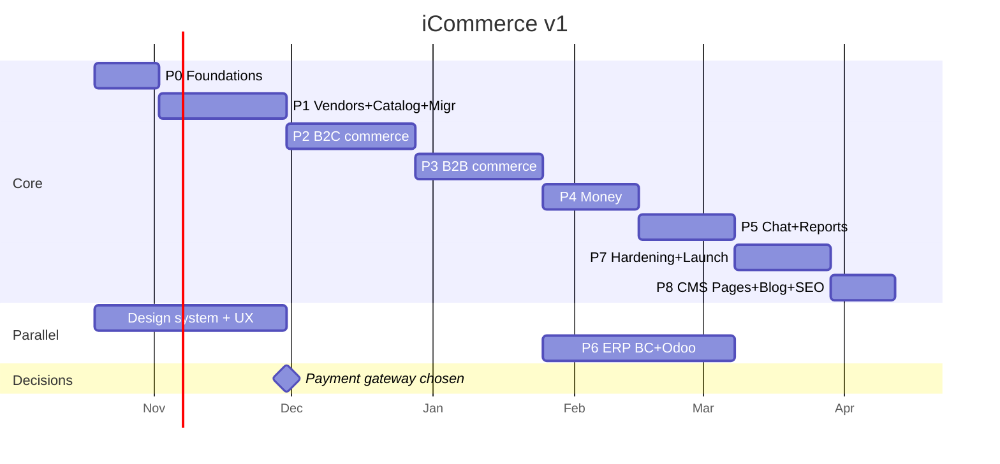

# 03 — Roadmap v1

Based on [02-architecture.md](02-architecture.md). **Team = Claude + subagents** (orchestrator plans/reviews; parallel builder agents per module in isolated worktrees; reviewer agent per PR; QA agent runs Playwright). Human (owner) = product decisions, UAT, credentials/accounts. Estimates = calendar weeks, bottleneck = owner review + external access (ERP, gateway), not coding speed.

## Summary
| Phase | Goal | Weeks | Milestone |
|---|---|---|---|
| P0 | Foundations + design system | 2 | Skeleton deployed to staging |
| P1 | Vendors + catalog + WP migration | 4 | **M1** — 1.2k vendors, 17k products live on staging |
| P2 | B2C commerce | 4 | **M2** — retail buyer can buy from 2+ vendors in one cart |
| P3 | B2B commerce | 4 | **M3** — company RFQ → quote → order on net terms |
| P4 | Money: fees, commission, payouts, plans | 3 | **M4** — every order splits correctly into vendor / commission / fee |
| P5 | Chat + reports | 3 | vendor dashboard complete |
| P6 | ERP (BC + Odoo) | 3 (parallel P4–P5) | **M5** — orders appear in BC + Odoo |
| P7 | Hardening + launch | 3 | **GO-LIVE** |
| P8 | CMS: pages, blog, SEO | 2 | admin can publish pages/posts, storefront renders + indexes them |
| | **Total** | **~25 weeks (~6 months)** — agent parallelism can compress P1–P6 to ~14–16 wks if owner reviews keep pace | |

Start date placeholder: 2026-10-19 → go-live ≈ **end Mar 2027**.

---

## P0 — Foundations (2 wks)
- **Design system** (Claude Design): iCommerce brand tokens (Gosoor palette), type, components → source for `packages/ui`.
- Turborepo + pnpm: `apps/backend` (Medusa v2), `apps/storefront`, `apps/vendor`, `packages/ui|sdk|config`.
- Docker compose dev: Postgres, Redis, Meilisearch, MinIO (R2 stand-in).
- Auth actors: customer, vendor_user, admin user (+ roles).
- next-intl EN/AR + RTL, shadcn theme tokens, base layouts for both Next apps.
- CI: lint, typecheck, test, build; staging deploy on merge to `main`. Sentry wired.
- `.gitignore`: `Old WP Project/`, secrets.

**Done when:** login works in all 3 apps on staging, EN/AR switch works.

## P1 — Vendors + catalog + migration (4 wks)
- `vendor` module: onboarding form, KYC docs (private R2), admin approval flow, store profile page.
- Product extras: unit, MOQ/max/step, HS code, cost price, b2b_only / b2c_enabled, origin.
- Vendor portal: product list/create/edit, images, variants, **CSV/Excel bulk import**, review status (draft → pending → live).
- Categories (97, cleaned) + attributes (unit/color/size). Meilisearch index + sync.
- `tools/migrate-wp`: dump → temp MySQL → import vendors, users, products, images → R2, sales org, fee tiers. Idempotent (`legacy_id`), dry-run report.
- Storefront read-only: home, category, search, product page, vendor store page.
- Redirect map WP → new URLs.

**Done when (M1):** full migration dry-run on staging, counts match audit, vendors can log in (reset-password invite) and edit products.

## P2 — B2C commerce (4 wks)
- Cart with items from N vendors, per-vendor shipping options (flat / zone / free over X / pickup).
- Checkout: address, shipping per vendor, payment. **Gateway parked → v1 interim: COD + bank transfer (proof upload)**; card gateway plugs in when chosen.
- Order placed → split into vendor_orders. Vendor portal: orders list/detail, status, tracking, invoice PDF.
- Customer account: orders, addresses, wishlist, reviews. Emails (Resend): order placed / shipped / delivered, EN/AR.
- Returns/refund request (basic: request → vendor approve → admin refund).

**Done when (M2):** E2E test: guest → account → cart from 2 vendors → COD order → both vendors ship → delivered.

## P3 — B2B commerce (4 wks)
- `company` module: company signup, members + roles (admin/buyer/approver), KYC (Tax ID, CR No., Export Card) → admin verify.
- Price lists: `b2b_verified` wholesale + qty breaks; per-company contract price list.
- B2B storefront mode: wholesale prices, MOQ enforcement, "Request quote" on b2b_only products, bulk add (quick order by SKU).
- `quote` module: RFQ → vendor offer → counter → accept (approver) → order; expiry cron; quote messages.
- Payment modes: upfront (bank transfer/COD/gateway later) + **net terms**: credit account, limit, terms, invoice due, overdue block, reminders.

**Done when (M3):** verified company: RFQ → offer → counter → accept → order on net 30 → invoice due → marked paid.

## P4 — Money (3 wks)
- `fee` module: per-channel tier tables (B2B seeded from WP, B2C admin-set), checkout + quote fee line, snapshot.
- `commission` module: rules (global/plan/category/vendor/vendor_category × channel × dates), resolution, snapshot per line.
- Payout ledger: per vendor_order line `total − commission − refunds`; payout batches (admin marks paid, manual v1); vendor payouts page.
- `vendor_plan`: plans CRUD, subscriptions, limits enforcement, manual/invoice billing, migrate 5 WP subscriptions.
- Admin screens: fee tiers, commission rules, plans, payouts.

**Done when (M4):** test matrix of orders (B2C/B2B × plan × category rule × refund) → ledger values match spreadsheet.

## P5 — Chat + reports (3 wks)
- TalkJS: buyer↔vendor conversations tied to product / order / quote; unread badges; email notify; admin can view (disputes).
- Rollups `report_daily_vendor` (event-driven + nightly).
- Vendor dashboard KPIs + charts; reports: sales by period/product/category/country, B2B vs B2C, top buyers, CSV export.
- Admin reports: platform GMV, fees, commission, vendors, per branch/rep (sales org attribution).
- `sales_org` module: branches, reps, assignment on company/customer, copied to orders.

**Done when:** vendor sees correct numbers vs raw orders for seeded test month.

## P6 — ERP: Business Central + Odoo (3 wks dev, runs parallel P4–P5)
- `erp_sync`: outbox, worker, retries, dead-letter, `erp_link`, admin ERP Sync screen (filter, retry, error detail).
- `BusinessCentralAdapter` (Entra ID OAuth2, API v2.0): customers, vendors, items, salesQuotes, salesOrders/Invoices.
- `OdooAdapter` (JSON-RPC): res.partner, product.product, sale.order, account.move.
- Field mapping doc agreed with finance (chart of accounts for fee + commission lines).
- Sandbox tenants: BC sandbox + Odoo staging DB.

**Done when (M5):** 50 staging orders (mixed) land correctly in both ERPs; replay safe (no duplicates).

## P7 — Hardening + launch (3 wks)
- Security: vendor isolation tests, authz review, rate limits, audit log, pen-test checklist, secrets rotation (incl. old WP DB creds).
- Performance: Lighthouse ≥90 storefront, load test checkout + search, image CDN.
- SEO: sitemap, structured data, Search Console. (WP down since 2022 → old rankings gone, redirects low priority.)
- UAT with 5–10 pilot vendors + 3 pilot companies.
- Final migration from 2022 dump (WP down since 2022 → dump is final, no delta), DNS cutover, rollback plan.
- Vendor comms: invite emails EN/AR, onboarding guide, help center.

**Done when:** go-live checklist green, 1 week stable on prod.

## P8 — CMS: pages, blog, SEO (2 wks)
- `content` module: `page` (slug, title/body EN+AR, draft/published) and `post` (same + author, tags, excerpt, featured image, published_at).
- SEO fields per page/post (meta title, meta description, OG image, canonical) + site-wide defaults (title template, default OG image); sitemap (`next-sitemap`, already the planned WP-Sitemap replacement) includes published pages/posts alongside products/vendors.
- Admin UI: Pages + Blog list/editor screens, same list + inline-expand-detail pattern as Companies/Vendors; Markdown body v1 (no rich-text/WYSIWYG dependency — upgrade later if vendors/staff ask).
- Storefront: `/[locale]/pages/[slug]`, `/[locale]/blog` index + `/[locale]/blog/[slug]`, EN/AR, WCAG 2.2 AA, logical CSS/RTL per design principles. Images via the existing `file` module, no new storage.
- **Not a WP migration item**: `01-wp-audit.md`'s extraction was catalog-only (vendors/products/categories/media) — the WP backup has no Pages/blog content to carry over. This phase is new content, authored fresh in the new admin.

**Done when:** admin publishes one page and one blog post in EN/AR; both render on storefront with correct `<title>`/meta tags and appear in the sitemap.

---

## Blocking decisions & deadlines
| Decision | Needed by | Impact if late |
|---|---|---|
| Payment gateway | end P1 (wk 6) | launch w/ COD + bank transfer only |
| BC + Odoo sandbox access + field mapping | start P6 (wk 14) | ERP slips, launch without sync |
| B2C fee values, default commission %, plan prices | start P4 (wk 14) | config only, not blocking dev |
| ~~Brand~~ → **iCommerce**, Gosoor colors; design via **Claude Design** (Design System + Design artifacts) | ✅ | |

## Risks
| Risk | Mitigation |
|---|---|
| Medusa v2 learning curve (team knows Prisma/tRPC) | P0 spike: build 1 custom module end-to-end first |
| Multi-vendor order split + refunds edge cases | M4 test matrix, ledger never computed on the fly (snapshots) |
| Vendors don't come back (WP had 1.2k signed up, inactive since 2022; contact data 4 yrs old) | re-onboarding campaign in P7; migration keeps their catalog → low effort for them |
| Buyers never came on WP | v1 scope must include marketing basics: SEO, landing pages, email capture — not just features. CMS lands in P8; if a landing/SEO page is needed for go-live itself, pull a minimal slice (page + global SEO, no blog) into P7 |
| ERP mapping disputes with finance | mapping doc signed off before P6 dev |
| Arabic content gap (catalog ~100% EN) | AR UI v1; product AR translation via vendor portal + optional AI translate post-v1 |

## Post-v1 backlog (not in scope)
- Platform logistics (fulfillment provider: Bosta/Aramex/own fleet)
- ERP pull: stock, prices, payment status from BC/Odoo
- Automated plan billing + instant payouts (after gateway)
- Mobile app (PWA first)
- AI: product AR translation, description generation, search relevance
- Advanced analytics (ClickHouse), funnels, cohorts
- Vendor ads / sponsored listings
